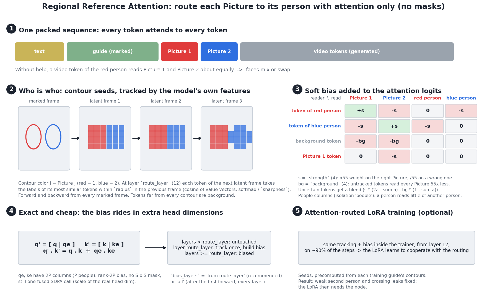

# H3 Regional Reference Attention

**BFS H3 Regional Reference Attention** routes each reference picture to its own person inside MiniMax H3's attention.
It uses no masks: nothing is blocked, and the attention only gets a soft push toward the right picture. It works with
the H3 video face swap (Ref2VA) and the H3 Image face swap.

**Interactive explainer** (side-by-side videos, the mechanism, live simulators for every parameter):
https://claude.ai/artifact/KFuYAX6zLgtMejj5QZuc3H

> **Attention backends.** Works with PyTorch SDPA / FlashAttention and SageAttention
> (`--use-sage-attention`). **Not compatible with Model Sparse Attention (sol-attn)** or other
> block-sparse / block-replacing attention nodes: they run their own kernel on the calls they take and
> never pass them to this node, so the routing is silently off there, and fully off when block
> `route_layer` is one of them. The node logs a warning when it detects one. Remove the sparse node
> while using Regional Reference Attention.



## The problem

H3 packs everything into one sequence, `[text | guide | Picture 1 | Picture 2 | ... | target]`, and every token attends
to every token. Nothing tells a target token of person 1 that Picture 1 is "its" picture. With two or more people,
faces mix, come out swapped, or land on someone who should keep their own face, and the second person often comes out
weak.

## How it works

1. **Seeds.** The BFS Video Segment Picker in **Multi Face Swap — Sparse Face Contour** mode draws a thin closed line on
   the inner border of each picked face, in a few frames. Color j means Picture j: red = 1, blue = 2, green = 3,
   yellow = 4. This mode needs InsightFace with `buffalo_l` in `models/insightface`.
2. **Tracking.** On the first pass through block `route_layer` (12 of 50), the node reads the model's own value vectors
   for the guide tokens. It follows each person from the marked frames to every latent frame by label propagation:
   - each token takes the labels of its most similar tokens within `radius` in the previous or next frame;
   - the weights are softmax(cosine / `sharpness`);
   - tokens far from every contour are background, and a token with no similar neighbor (a camera cut, a new person)
     gets no label.

   The tracking runs once and is reused for every later block and sampling step.
3. **Bias.** Each token gets `strength·(2·a_j − Σa) − background·(1 − Σa)` added to its logit toward Picture j, where
   `a_j` is its affinity to person j:

   | token | toward Picture j | toward the other pictures |
   |---|---|---|
   | person j (sure) | +strength | −strength |
   | nobody (background, unpicked people) | −background | −background |
   | Picture i rows | 0 (own) | −strength |

   With `isolation` = people, a person also reads little of the other generated people. Picture j's keys include its
   vision tokens inside the text sequence.
4. **Exact and cheap.** The bias has rank 2P, so it is appended as extra head dimensions (`q' = [q | qe]`,
   `k' = [k | ke]`, scale of the real head dim). It stays one fused attention call with no S×S mask.

A logit of +4 multiplies an attention weight by e⁴ ≈ 55. With strength 4, the right picture gets about 55× more weight
and a wrong one about 55× less.

**H3 Image.** The marked guide is reference image 1, and the pictures follow from image 2. The contours are the owners
directly (one frame, nothing to propagate); they are resized from the guide's token grid to the target's. Only soft
routing is supported there.

## Wiring

**Video (Ref2VA face swap):**

```
Video Segment Picker (Multi Face Swap — Sparse Face Contour)
  ├─ hybrid ──► BFS H3 Face Swap • Auto Subjects ─ positive ─┐
  │                                                          ├─► BFS H3 Regional Reference Attention ─ MODEL ─► sampler
  └─ hybrid ──────────────────────────────── guide ──────────┘        (model from the LoRA loader)
```

Connect the same `positive` that goes to the sampler. The node only reads it to find each picture's vision tokens.
`guide` is the picker's `hybrid`, the same image the conditioning uses.

**H3 Image:** put the node between the model (after the LoRA loader) and the KSampler. Give it the H3 Image face swap
`positive` and the same marked guide image.

When the node finds no contour colors, the console prints `no contour colors found in the guide: attention tracking is
off`. When the picker could not draw a face's line, it prints `no contour found for picture(s) [...]`, and that picture
stays neutral.

## Attention backends

| backend | works | notes |
|---|---|---|
| PyTorch SDPA / FlashAttention | yes | the normal path |
| SageAttention (`--use-sage-attention`) | yes | blocks before `route_layer` stay on Sage; the biased blocks run PyTorch SDPA (the bias needs extra head dimensions), so they lose Sage's speedup |
| Attention backends that swap the default function (e.g. Model Attention Backend) | likely | same as Sage: unbiased blocks keep the backend; not tested |
| **Model Sparse Attention (sol-attn)**, VSA | **no** | the sparse node puts itself on top of every other attention override (and re-installs each step) and replaces the H3 blocks; its kernel never calls this node, so tracking and bias are skipped |
| other block-sparse nodes (e.g. Spark-H3) | probably not | if they replace the blocks or do not pass calls down the override chain, the routing is skipped |

Making the two work together needs one of:
- the sparse kernel leaving the biased blocks to this node, which drops most of the speedup;
- the bias implemented inside the sparse kernel, with text, guide and picture blocks always kept (sinks).

Neither exists yet.

## Parameters

| parameter | default | what it does |
|---|---|---|
| `guide` | — | The marked guide (picker `hybrid` in Sparse Face Contour mode). The recommended input. |
| `routing` | soft | **soft**: bias only. **hard**: blocked attention; kills the swap, kept for comparison. |
| `strength` | 4.0 | Push toward the right picture and away from the wrong ones. Above 6 became unstable. |
| `background` | 4.0 | Push away from every picture for tokens of nobody, so identity stays off the background and unpicked people. 8 suppressed real swaps wherever tracking missed part of a face. |
| `route_layer` | 12 | Block whose features track the people. With an attention-trained LoRA, keep the value it was trained with. |
| `bias_layers` | from route layer | **from route layer**: bias only from the tracking block on (what an attention-trained LoRA saw). **all**: every block after the first pass. |
| `bias_start` / `bias_end` | 0 / 0 | First and last block that get the bias (0 = from `bias_layers` / to the last block). The face identity is decided from about block 24: `bias_start` 24 kept the quality of 12–49 in tests and ran about 30% faster. |
| `sharpness` | 0.05 | Temperature of the tracking similarity. Lower means crisper labels. |
| `radius` | 3 | How far (in 32 px tokens) a person may move between two latent frames (4 video frames). |
| `tracking` | propagate | **propagate + match** also matches unreached tokens to the marked frames of the whole clip. No measurable gain in tests. |
| `isolation` | people | **people**: a person also reads little of the other people. **pictures only**: picture columns only. **people + text**: hard routing only. |
| `subject_map`, `margin`, `dilate`, `outside_subjects` | — | Hard routing / mask mode only. Ignored by soft routing. |

## Results (ArcFace, two people)

Each cell is red margin / blue margin / leak. A margin is right picture minus wrong picture, so higher is better and
negative means the wrong face won. Leak is how much a person who should keep their face looks like a picture, so lower
is better.

| clip | face swap LoRA, no node | face swap LoRA + node | attention-trained LoRA @0.8 + node |
|---|---|---|---|
| A: people cross | −0.50 / 0.61 / 0.52 | 0.40 / 0.60 / 0.15 | **0.56 / 0.49 / 0.01** |
| B: easy | −0.68 / −0.68 | 0.70 / 0.55 | 0.63 / 0.61 |
| C: weak second person | −0.66 / −0.44 / 0.44 | 0.52 / 0.33 / 0.06 | **0.56 / 0.52 / 0.04** |
| E: camera cut | −0.69 / −0.19 / 0.08 | 0.35 / 0.08 / 0.06 | 0.22 / −0.07 / 0.06 |
| F: 3× speed | −0.44 / −0.46 / 0.38 | **0.75 / 0.35 / 0.04** | 0.66 / 0.43 / 0.14 |

- The node alone turns swapped identities into correct ones, even at 3× speed.
- A LoRA trained with the routing on balances the two people and removes the leak when they cross. That LoRA needs the
  node at inference; without it, identities come out swapped.
- **Limits.**
  - Faces of about one 32 px token.
  - People who are not marked again after a camera cut (clip E): the propagation cannot cross a cut.
  - It decides whose identity goes where; it adds no resolution. Distorted small faces still need a crop-and-refine
    pass.

## What it is not

It is not a mask. H3 regenerates the whole image or video either way, and the node changes which picture each region
reads; it does not copy pixels back. The background push keeps identity off clothes, the scene and unpicked people (in
tests the leak onto them dropped from 0.4–0.5 to about 0.05). A pixel-exact background still needs compositing.

## Training a LoRA with the routing on

The same tracking and bias can run inside the trainer, so the LoRA learns to swap under the routing. The ai-toolkit
changes (the training hook, the seed precompute tool, and the config) are on the
[`feat/h3-regional-attention`](https://github.com/alisson-anjos/ai-toolkit/blob/feat/h3-regional-attention/extensions_built_in/diffusion_models/minimax_h3/REGIONAL_ATTENTION.md)
branch of the ai-toolkit fork. That page shows how to enable the routing and how to port it to another model.
